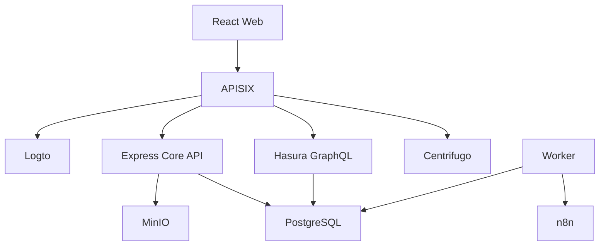

<h1 align="center">Module Workspace</h1>

<p align="center">
  Không gian làm việc chung cho ứng dụng, dữ liệu và quy trình của tổ chức.
</p>

<p align="center">
  <a href="LICENSE"></a>
  
  
</p>

Module Workspace là nền tảng quản lý hồ sơ và công việc cho tổ chức. Quản trị viên có thể tạo ứng dụng, thiết kế bảng dữ liệu, biểu mẫu và thiết lập quy trình phê duyệt. Thành viên sử dụng những ứng dụng này để nhập liệu, gửi yêu cầu, trao đổi và theo dõi kết quả xử lý.

## Mục lục

- [Giới thiệu](#giới-thiệu)
- [Tính năng chính](#tính-năng-chính)
- [Kiến trúc hệ thống](#kiến-trúc-hệ-thống)
- [Công nghệ sử dụng](#công-nghệ-sử-dụng)
- [Cấu trúc dự án](#cấu-trúc-dự-án)
- [Hướng dẫn cài đặt](#hướng-dẫn-cài-đặt)
- [Sử dụng mẫu Văn phòng số](#sử-dụng-mẫu-văn-phòng-số)
- [Phân quyền và dữ liệu](#phân-quyền-và-dữ-liệu)
- [API nghiệp vụ](#api-nghiệp-vụ)
- [Vận hành và triển khai](#vận-hành-và-triển-khai)
- [Đóng góp](#đóng-góp)
- [Giấy phép](#giấy-phép)

## Giới thiệu

### Bài toán

Trong một tổ chức, hồ sơ thường được lưu ở bảng tính, tài liệu nằm trong thư mục dùng chung, còn việc trao đổi và phê duyệt diễn ra qua tin nhắn. Khi cần tìm lại một yêu cầu, người xử lý phải đối chiếu nhiều nơi để biết dữ liệu nào mới nhất và ai đang phụ trách.

Các bộ phận cũng có nhu cầu khác nhau: phòng hành chính quản lý đề nghị mua sắm, nhân sự tiếp nhận đơn nghỉ phép, trường học lưu hồ sơ học sinh. Những nghiệp vụ này khác nhau về thông tin cần thu thập nhưng thường dùng chung các thao tác nhập liệu, tìm kiếm, đính kèm và phê duyệt.

### Cách tiếp cận

Module Workspace tập trung những thao tác chung đó vào một hệ thống. Cấu trúc bảng dữ liệu và biểu mẫu được lưu dưới dạng cấu hình, cho phép quản trị viên điều chỉnh các trường thông tin ngay trên giao diện.

Mỗi tổ chức quản lý dữ liệu và thành viên của mình. Một tài khoản có thể tham gia nhiều tổ chức với vai trò khác nhau.

### Đối tượng sử dụng

| Đối tượng | Nhu cầu |
| --- | --- |
| Quản trị viên tổ chức | Tạo ứng dụng, thiết kế biểu mẫu và quản lý thành viên |
| Nhân viên, thành viên | Nhập hồ sơ, gửi yêu cầu và theo dõi kết quả |
| Người phê duyệt | Xem nội dung, tài liệu đính kèm và xử lý yêu cầu |
| Nhà phát triển | Kết nối API và bổ sung logic nghiệp vụ |

## Tính năng chính

### Ứng dụng và dữ liệu

- Tạo ứng dụng và các bảng dữ liệu theo nhu cầu của tổ chức.
- Thiết kế biểu mẫu với trường văn bản, số, ngày, boolean và danh sách lựa chọn.
- Thiết lập trường bắt buộc, quyền đọc và quyền ghi.
- Tạo, sửa, xóa hồ sơ nháp; tìm kiếm, lọc trạng thái và phân trang.
- Kiểm tra phiên bản hồ sơ khi lưu để tránh ghi đè thay đổi của người khác.

### Hồ sơ và phê duyệt

- Đính kèm tài liệu PDF, PNG, JPEG và TXT.
- Trao đổi bằng bình luận trên hồ sơ.
- Gửi duyệt và xử lý yêu cầu theo quy trình một cấp.
- Cho phép sửa, gửi lại hồ sơ bị từ chối; không cho phép tự phê duyệt.
- Tạo ứng dụng từ mẫu Văn phòng số với nghiệp vụ đề nghị mua sắm.

### Quản lý tổ chức

- Đăng nhập tập trung qua Logto.
- Quản lý thành viên với bốn vai trò: `owner`, `admin`, `editor` và `viewer`.
- Theo dõi thống kê, nhật ký hoạt động và thông báo cá nhân.
- Cập nhật giao diện qua WebSocket khi có sự kiện mới.

## Kiến trúc hệ thống

Hệ thống gồm giao diện web và các dịch vụ phía server. Người dùng truy cập qua APISIX; các dịch vụ dữ liệu, xác thực, lưu trữ và xử lý workflow chạy trong mạng Docker nội bộ.



Express xử lý các nghiệp vụ như phân quyền, kiểm tra dữ liệu, phê duyệt và truy cập tệp. Hasura cung cấp GraphQL để đọc dữ liệu theo quyền và thao tác với bình luận. Worker đọc sự kiện từ outbox để chuyển sang quy trình xử lý bất đồng bộ.

Gateway kết nối thêm mạng `edge`; mặc định chỉ mở cổng trên loopback. Các cổng quản trị được mở riêng bằng `compose.admin.yaml` khi cấu hình hoặc bảo trì.

## Công nghệ sử dụng

| Thành phần | Công nghệ | Vai trò |
| --- | --- | --- |
| Giao diện | React, TypeScript, Vite | Giao diện quản lý ứng dụng và hồ sơ |
| API Gateway | Apache APISIX | Điều hướng, xác thực tại gateway và giới hạn lưu lượng |
| Định danh | Logto | Đăng nhập SSO/OIDC và quản lý tài khoản |
| API nghiệp vụ | Express, TypeScript | Xử lý dữ liệu động, phân quyền và phê duyệt |
| Cơ sở dữ liệu | PostgreSQL | Lưu cấu hình, hồ sơ và sự kiện |
| GraphQL | Hasura | Truy vấn dữ liệu với quyền truy cập |
| Lưu trữ tệp | MinIO | Lưu tài liệu trong bucket riêng tư |
| Workflow | n8n | Xử lý quy trình và thông báo bất đồng bộ |
| Thời gian thực | Centrifugo | Chuyển thông báo qua WebSocket |
| Triển khai | Docker Compose | Cấu hình và chạy các dịch vụ |

## Cấu trúc dự án

| Đường dẫn                   | Nội dung                                                  |
| --------------------------- | --------------------------------------------------------- |
| `web/`                      | React TypeScript, UI, Dockerfile, nginx                   |
| `server/core/`              | Express, worker, migration runner, Hasura metadata loader |
| `server/db/`                | Khởi tạo database/user và SQL migrations                  |
| `server/apisix/`            | APISIX standalone config                                  |
| `server/logto/`             | Cấu hình và hướng dẫn SSO                                 |
| `server/hasura/`            | Metadata, relationships, permissions                      |
| `server/n8n/`               | Workflow template, cách vận hành                          |
| `server/minio/`             | Private bucket initializer                                |
| `server/centrifugo/`        | Chính sách realtime                                       |
| `server/scripts/`           | Sinh config, bootstrap, backup                            |
| `server/compose.yaml`       | Stack container đầy đủ                                    |
| `server/compose.dev.yaml`   | Chạy Express và Vite trên host                            |
| `server/compose.admin.yaml` | Console loopback trong thời gian bảo trì                  |

## Hướng dẫn cài đặt

### Yêu cầu môi trường

Cần Docker Engine, Docker Compose 2.24.4 trở lên và Python 3.10 trở lên. Khi chạy chế độ phát triển, cài thêm Node.js 22 và npm. Khuyến nghị máy có ít nhất 8 GB RAM và kết nối Internet để tải image, dependency.

Tên miền local: `localhost` cho app và `auth.localhost` cho Logto. Nếu hệ điều hành không tự resolve `auth.localhost`, thêm vào `/etc/hosts`:

```text
127.0.0.1 auth.localhost
```

### Chạy bằng Docker Compose

Từ thư mục dự án:

```bash
cd server
python3 scripts/configure.py
docker compose -f compose.yaml -f compose.admin.yaml up -d --build
```

Script tạo `.env` từ `.env.example`, sinh các khóa bí mật và giữ nguyên giá trị đã cấu hình. Không đưa `.env`, `core/.env`, `generated/` hoặc bản sao lưu dữ liệu lên Git.

Sau khi các dịch vụ sẵn sàng:

1. Mở `http://localhost:3002`, tạo quản trị viên Logto.
2. Tạo ứng dụng **Single-page app / React**. Redirect URI `http://localhost:8080/callback`; post sign-out URI `http://localhost:8080`.
3. Tạo API resource với identifier `https://api.sharebase.local`. Bật username/password đăng nhập và đăng ký trong Sign-in experience.
4. Điền application ID vào `LOGTO_APP_ID` trong `server/.env`.
5. Mở `http://localhost:5678`, tạo tài khoản owner n8n; không cần tạo workflow thủ công.
6. Từ `server`, hoàn tất cấu hình:

```bash
python3 scripts/configure.py
sh scripts/bootstrap.sh prod
docker compose -f compose.yaml -f compose.admin.yaml restart web gateway
```

Bootstrap áp dụng Hasura metadata, import/publish workflow và restart n8n. Nếu n8n chưa chạy xong migration, chờ log khởi động xong rồi chạy lại bootstrap; dữ liệu nghiệp vụ không bị xóa.

Đóng các port bảo trì, giữ dữ liệu trong volume:

```bash
docker compose up -d --force-recreate logto n8n
```

Mở **http://localhost:8080**. Khi đổi giá trị môi trường cho container, dùng `up -d --force-recreate <service>`; `restart` không nạp lại environment.

### Chạy môi trường phát triển

Nếu stack production đang chạy, dừng container nhưng giữ volume:

```bash
cd server
docker compose down
python3 scripts/configure.py --dev
docker compose -f compose.yaml -f compose.dev.yaml -f compose.admin.yaml up -d --build
```

Lần đầu vẫn thiết lập Logto và owner n8n như phần trên. Sau khi sửa `LOGTO_APP_ID`, chạy lại `python3 scripts/configure.py --dev`.

Terminal 1, từ `server/core`:

```bash
npm install
npm run dev
```

Terminal 2, từ `server/core`:

```bash
npm run worker:dev
```

Terminal 3, từ `web`:

```bash
npm install
npm run dev
```

Terminal 4, từ `server`:

```bash
sh scripts/bootstrap.sh dev
```

**Luôn mở http://localhost:8080**, không dùng cổng 4000/5173 làm origin đăng nhập. APISIX chuyển request sang `host.docker.internal:4000` và `host.docker.internal:5173`. Express/Vite bind `0.0.0.0` để container gọi được; dùng firewall của máy dev giới hạn truy cập các cổng này từ LAN nếu cần.

`tsx watch` tự restart Express/worker khi sửa mã nguồn. Có thể dừng bằng Ctrl+C và chạy lại. Không cần rebuild container Core khi sửa TypeScript trong chế độ dev. `migrate` vẫn chạy dưới dạng job container; nếu thêm migration có thể dùng `npm run migrate` từ `server/core`.

Đổi về chế độ container:

```bash
# Dừng các tiến trình npm dev trước.
cd server
docker compose -f compose.yaml -f compose.dev.yaml down
python3 scripts/configure.py
docker compose up -d --build
sh scripts/bootstrap.sh prod
```

Không chạy `docker compose down -v` nếu muốn giữ dữ liệu. Dùng cùng thư mục `server/.env` cho cả hai chế độ để tránh lệch password với volume.

### Địa chỉ truy cập

| Dịch vụ | Địa chỉ | Ghi chú |
| --- | --- | --- |
| Ứng dụng | http://localhost:8080 | Truy cập qua gateway ở cả chế độ dev và container |
| Đăng nhập | http://auth.localhost:8080 | Endpoint xác thực của Logto |
| Logto Console | http://localhost:3002 | Cần bật `compose.admin.yaml` |
| n8n | http://localhost:5678 | Cần bật `compose.admin.yaml` |

Identifier `https://api.sharebase.local` trong cấu hình Logto là định danh API, không phải địa chỉ web cần truy cập. Giá trị này phải khớp với cấu hình resource của frontend và backend.


## Sử dụng mẫu Văn phòng số

1. Đăng nhập người A, tạo tổ chức “Công ty Bình Minh”. A tự trở thành owner của tổ chức đó.
2. Mở Ứng dụng → **Dùng mẫu Văn phòng số**. Bảng Đề nghị mua sắm có tên hàng hóa, dự toán, lý do và ngày cần; workflow bật sẵn.
3. Đăng nhập người B bằng cửa sổ riêng. B vào Thành viên để lấy subject (nếu chưa có tổ chức, subject hiển thị ở chân menu). A thêm B với role editor.
4. B chọn tổ chức, tạo hồ sơ, nhập dữ liệu, đính kèm tệp rồi gửi duyệt.
5. A nhận thông báo, mở Trung tâm phê duyệt, bấm tên hồ sơ để xem nội dung/tệp rồi phê duyệt hoặc từ chối.
6. B nhận thông báo kết quả. Dashboard và nhật ký phản ánh thao tác.
7. Tạo tổ chức thứ hai bằng tài khoản khác để minh họa cách ly dữ liệu. Một tài khoản chỉ thấy các tổ chức mình là thành viên.

Có thể tự tạo ứng dụng và biểu mẫu theo nhu cầu của tổ chức. Vai trò `owner` thuộc từng tổ chức và chịu trách nhiệm quản lý thành viên, cấu hình ứng dụng trong tổ chức đó.

## Phân quyền và dữ liệu

| Role   | Quyền                                                                                                           |
| ------ | --------------------------------------------------------------------------------------------------------------- |
| owner  | Quản trị tổ chức, quản lý admin, thiết kế ứng dụng; được duyệt nhưng không tự duyệt                             |
| admin  | Thiết kế ứng dụng/biểu mẫu, quản lý editor/viewer, sửa hồ sơ trong tổ chức; duyệt khi vai trò quy trình là admin |
| editor | Tạo hồ sơ, sửa/gửi hồ sơ của mình; duyệt hồ sơ người khác khi vai trò quy trình là editor                       |
| viewer | Đọc hồ sơ và những trường được cấp quyền, tải tệp; không thay đổi dữ liệu                                       |

Phân quyền trong phiên bản này dựa trên tổ chức, vai trò và trường dữ liệu; chưa hỗ trợ vai trò tùy chỉnh hoặc phân quyền theo phòng ban, bảng dữ liệu. Tất cả thành viên tổ chức thấy tiêu đề, trạng thái hồ sơ và các tệp trong tổ chức; không đưa thông tin chỉ-admin vào tiêu đề/tệp nếu muốn ẩn bằng field permissions.

Schema động sử dụng `fields` và từng dòng JSONB `record_values`. Metadata Hasura có thể lọc từng giá trị; Core cũng áp dụng quyền này. Khóa ngoại ghép chặn liên kết chéo tổ chức. Chi tiết ở `server/db/README.md`.

Audit ứng dụng ghi trong transaction của Core. CRUD comments qua Hasura không tạo audit Core; lịch sử comments hiện chỉ có tác giả/thời điểm tạo. Database owner có thể sửa database: audit không phải sổ cái bất biến.

## API nghiệp vụ

API nghiệp vụ cần `Authorization: Bearer <Logto access token>` và `X-Tenant-Id: <organization UUID>`. `/api/me` và tạo tổ chức không cần tổ chức đã tồn tại.

| Endpoint                                | Mục đích                                       |
| --------------------------------------- | ---------------------------------------------- |
| GET `/api/me`                           | Subject và tổ chức hiện có                     |
| POST `/api/organizations`               | Tạo tổ chức và owner                            |
| GET/PUT/DELETE `/api/members[/subject]` | Danh sách, gán role, gỡ thành viên             |
| GET/POST `/api/apps`                    | Ứng dụng                                       |
| POST `/api/templates/office`            | Tạo mẫu Văn phòng số                           |
| GET/POST `/api/collections`             | Bảng dữ liệu                                   |
| PATCH `/api/collections/:id`            | Tên và cấu hình workflow                       |
| GET/POST `/api/collections/:id/fields`  | Trường và quyền                                |
| GET/POST `/api/collections/:id/records` | Danh sách và tạo hồ sơ                         |
| GET/PATCH/DELETE `/api/records/:id`     | Chi tiết, sửa có version, xóa nháp             |
| POST `/api/records/:id/submit`          | Gửi duyệt                                      |
| GET `/api/approvals`                    | Yêu cầu của mình / cần mình duyệt              |
| POST `/api/approvals/:id/decide`        | Quyết định và nhận xét                         |
| GET/POST `/api/records/:id/files`       | Tệp đính kèm                                   |
| GET `/api/files/:id/download`           | Tải tệp có kiểm tra quyền trong tổ chức                    |
| GET `/api/dashboard`                    | Thống kê                                       |
| GET `/api/notifications`                | Thông báo cá nhân                              |
| POST `/api/notifications/read`          | Đánh dấu đã đọc                                |
| GET `/api/realtime/token`               | JWT Centrifugo ngắn hạn                        |
| GET `/api/audit`, GET `/api/operations` | Nhật ký và outbox                              |
| POST `/api/operations/:id/retry`        | Lên lịch lại sự kiện                           |
| POST `/v1/graphql`                      | Hasura đọc dữ liệu phân quyền và CRUD comments |

Ví dụ tạo hồ sơ: `{"title":"Mua máy chiếu","data":{"item":"Máy chiếu","amount":15000000,"reason":"Phòng họp"}}`. Khi sửa, thêm `version` lấy từ lần đọc gần nhất. Server trả 409 khi version đã cũ.

## Vận hành và triển khai

### Theo dõi và sao lưu

- `docker compose logs -f core worker n8n` theo dõi xử lý nghiệp vụ và sự kiện.
- `docker compose logs -f db migrate logto` theo dõi khởi tạo.
- Dùng màn hình Vận hành để xem và retry sự kiện bị lỗi. Retry không tạo thông báo trùng trong database.
- Mặc định worker chạy một instance; dùng SKIP LOCKED và lease cho phép mở rộng khi cần. Sự kiện giao at-least-once; realtime có thể lặp refresh.
- `sh scripts/backup.sh` tạo snapshot database và object volume trong thời gian bảo trì. Script tạm dừng lưu lượng và writers trước khi chụp cả hai; dùng cho stack production mặc định. Sao lưu `.env` riêng bằng phương tiện mã hóa vì có n8n encryption key.
- Khôi phục trên môi trường trống: khởi động riêng `db` (dùng đúng secret), nhập dump với `psql -U postgres`, khôi phục archive vào MinIO `/data` khi service đang dừng, rồi khởi động stack. `pg_dumpall` chứa roles và database; khi khôi phục vào DB đã init, cần xử lý các role/database đã tồn tại thay vì nhập đè tùy tiện.
- Tệp đính kèm không có chức năng xóa trong UI; hồ sơ có tệp hoặc lịch sử phê duyệt được giữ lại. MinIO versioning hỗ trợ khôi phục nhưng cần chính sách retention/lifecycle riêng cho vận hành dài hạn.

Nếu lỗi `password authentication failed`, `.env` và password trong volume có thể không khớp. Khôi phục `.env` ban đầu hoặc đổi password của đúng role bằng tài khoản quản trị PostgreSQL, rồi recreate dịch vụ dùng credential đó. Không xóa volume khi cần giữ dữ liệu hiện có.

### Triển khai trên máy chủ

`compose.yaml` chạy toàn bộ dịch vụ bằng container, nhưng cấu hình mặc định dùng HTTP trên máy cục bộ. Để đưa ra Internet:

- Dùng hai domain HTTPS cho app và Logto, TLS load balancer chuyển đến APISIX. Không forward bất kỳ cổng lõi/admin nào ra Internet.
- Đặt `PUBLIC_ORIGIN`, `AUTH_ORIGIN`, redirect URI và sign-out URI theo domain HTTPS; render config rồi recreate các dịch vụ bị thay đổi.
- Nếu load balancer ở máy khác, chỉnh `GATEWAY_BIND` và firewall chỉ cho IP load balancer gọi gateway. Cấu hình trusted proxy/real IP chính xác trước khi rate-limit theo địa chỉ người dùng.
- Quản lý khóa bí mật riêng theo môi trường, duy trì lockfile và cố định phiên bản image đã kiểm thử trước khi triển khai.
- Bổ sung antivirus/quarantine và giới hạn lưu trữ trước khi nhận tệp công khai; MIME allowlist không thay thế kiểm dịch.
- Nếu cần email/external workflow, bổ sung egress proxy/rule cho đúng dịch vụ. Mạng internal hiện ngăn truy cập Internet từ các engine.

## Đóng góp

Bạn có thể đóng góp bằng cách báo lỗi, bổ sung tài liệu hoặc gửi pull request.

- Khi báo lỗi, ghi rõ bước tái hiện, kết quả mong đợi và log liên quan. Xóa token, mật khẩu và dữ liệu cá nhân trước khi gửi.
- Với thay đổi lớn, mở issue để trao đổi về phạm vi trước khi triển khai.
- Mỗi pull request nên tập trung vào một vấn đề, mô tả thay đổi và cách kiểm tra.

## Giấy phép

Mã nguồn Module Workspace được phát hành theo giấy phép MIT. Các dịch vụ bên ngoài được tải và chạy riêng trong quá trình triển khai, theo giấy phép của từng dự án.
